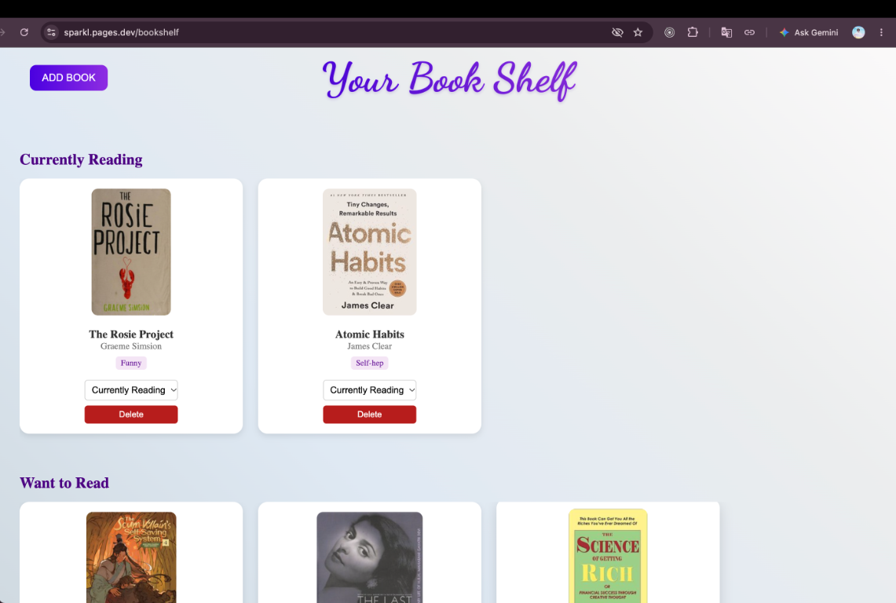
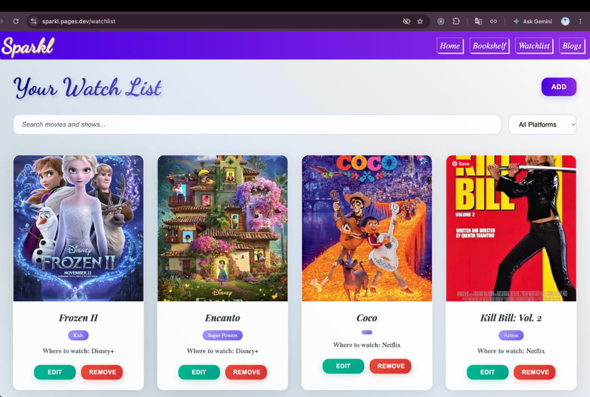

# Sparkl

Sparkl is a private personal hub for books, watchlists, blogs, Spotify, and
other everyday interests. Authenticated users can keep their own bookshelf,
watchlist, and journal entries in one place.

## Live demo

- Frontend: [sparkl.pages.dev](https://sparkl.pages.dev)
- Backend API: [sparkl.onrender.com](https://sparkl.onrender.com)
- Source: [kalviumcommunity/S47_Ishita_Capstone_Sparkl_](https://github.com/kalviumcommunity/S47_Ishita_Capstone_Sparkl_)

### Demo login

Use the following demo account on the live frontend:

```text
Email: demo@sparkl.app
Password: SparklDemo123!
```

If the demo account has been reset, register a new account from the login
screen. The backend is hosted on Render's free tier, so the first request
after inactivity can take 30-60 seconds while the service performs a cold
start.

## Screenshots





## Features

- JWT-based signup and login, plus Google OAuth
- Private, token-scoped books, watchlist, and blog routes
- Book search through [OpenLibrary](https://openlibrary.org/)
- Movie and series search through [OMDb](https://www.omdbapi.com/)
- Image uploads through Cloudinary
- Spotify Web API search/library integrations and an optional browser-local
  Web Playback SDK device. Browser playback requires a Spotify Premium account
  and an active browser device.

## API routes

All `/books`, `/watchList`, and `/blog` routes require
`Authorization: Bearer <JWT>`. The server derives the owner from the token;
clients do not provide a trusted user ID.

| Method | Route | Description |
| --- | --- | --- |
| POST | `/user/register` | Register and receive a JWT |
| POST | `/user/login` | Log in and receive a JWT |
| GET | `/auth/google` | Start Google OAuth |
| GET | `/books` | List the authenticated user's books |
| POST | `/books` | Create a book |
| PUT | `/books/update/:id` | Update an owned book |
| DELETE | `/books/delete/:id` | Delete an owned book |
| GET | `/watchList` | List the authenticated user's watchlist |
| POST | `/watchList` | Create a watchlist item |
| GET | `/watchList/item/:id` | Get an owned watchlist item |
| PUT | `/watchList/update/:id` | Update an owned watchlist item |
| DELETE | `/watchList/delete/:id` | Delete an owned watchlist item |
| GET | `/blog` | List the authenticated user's blogs |
| POST | `/blog` | Create a blog with image uploads |
| GET | `/blog/:id` | Get an owned blog |
| DELETE | `/blog/delete/:id` | Delete an owned blog |

## Tech stack

1. Frontend: React, Vite, Axios, React Router
2. Backend: Node.js, Express, JWT, Passport Google OAuth
3. Database: MongoDB with Mongoose
4. Integrations: Cloudinary, OpenLibrary, OMDb, Spotify
5. Testing: Node's built-in test runner, Supertest, MongoDB Memory Server

## Getting started

### Prerequisites

- Node.js 18 or newer
- npm
- MongoDB (local or hosted)

### Install

```bash
git clone https://github.com/kalviumcommunity/S47_Ishita_Capstone_Sparkl_.git
cd S47_Ishita_Capstone_Sparkl_

cd Server
npm install

cd ../Client
npm install
```

Copy `Server/.env.example` to `Server/.env` and replace every placeholder
with a local value. Set `VITE_SERVER` in `Client/.env` to the backend URL.
Never commit either `.env` file.

For local Spotify login, copy `Client/.env.example` to `Client/.env` and add
the exact URI `http://localhost:5173/home` to the Spotify Developer Dashboard
under **Redirect URIs**. Spotify permits `http://localhost` for local
development; production must use the exact deployed HTTPS URI, such as
`https://sparkl.pages.dev/home`. The URI in the dashboard and `VITE_REDIRECT_URI`
must match exactly, including the path and trailing slash.

### Run

Start the backend and frontend in separate terminals:

```bash
cd Server
npm start
```

```bash
cd Client
npm run dev
```

### Run automated tests

```bash
cd Server
npm test
```
